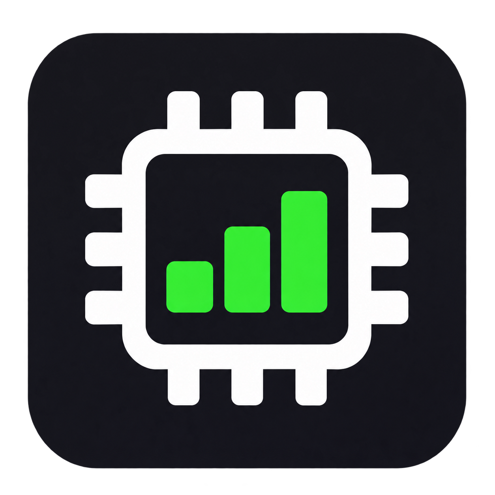

# GPU Dock



A small native Windows overlay showing which apps use your GPU. White text on a transparent background sits beneath the NVIDIA overlay at the top-right. The panel is click-through and does not take keyboard focus.

## Download and run

Download `GpuDock.exe` from the [**v1.1.1 release**](https://github.com/hkf57/gpu-dock/releases/tag/v1.1.1), save it in a permanent folder, and run it. Windows x64 and .NET Framework 4.8 are required. GPU performance counters must be available. The executable is unsigned.

Only the executable is needed to run the app; its icon is embedded. Startup is optional and can be enabled from the tray menu.

## Use

Run `GpuDock.exe`. Only one copy runs at a time. Right-click the GPU Dock tray icon (it may be inside the hidden-icons arrow) for controls:

- **Adjust layout:** drag the panel, then double-click it to finish. Normal click-through behavior returns automatically.
- **GPU:** an NVIDIA adapter is selected when available, otherwise the first detected hardware adapter. Choose another adapter from the tray menu.
- **Show free % row:** toggle a bottom row showing unused GPU activity capacity and free dedicated VRAM as percentages. A subtle divider separates it from app rows; both hide together. Enabled by default; the choice is saved.
- **Visible apps / Text size / Monitor:** adjust the panel to suit your screen.
- **Hide panel:** manually hide it while keeping the tray controls available.
- **Start with Windows:** enable or disable startup for the current Windows user.
- **Exit:** stop the utility.

Each row shows app name, smoothed GPU activity, and dedicated GPU memory. Up to three rows appear by default. Processes sharing an executable name are grouped. Apps with at least 0.3% smoothed activity or 64 MiB of dedicated allocations qualify. Updates arrive approximately every 1.5 seconds, slowing to 5 seconds while hidden.

The optional bottom row reads **Free | GPU % | VRAM %**. GPU free is 100 minus the selected adapter's smoothed busiest-engine utilization, after combining all processes on each engine. It is an activity estimate, not a promise of extra workload throughput. VRAM free is `(dedicated capacity − adapter-wide dedicated usage) / dedicated capacity × 100`, using DXGI capacity and Windows adapter memory counters. Neither figure is calculated by adding the displayed app rows. Missing or invalid data displays a dash; integrated adapters without dedicated capacity cannot report a dedicated-VRAM percentage.

## Gaming

The panel hides when a foreground app fills its monitor, Windows reports exclusive Direct3D fullscreen, or its executable is in a common Steam, Xbox, or Epic game directory. This deliberately also hides the panel for fullscreen video/browser apps. It returns about 0.9 seconds after leaving that state.

For a windowed game that is not recognized, press **Ctrl+Alt+G while the game has focus** to remember its executable. Press the same shortcut again to remove it. Remembered games can also be removed through the tray menu. Detection uses foreground-window metadata; it does not inject code into games.

## Reading limitations

Activity is the busiest GPU engine for each grouped app, smoothed across samples. Different engines run concurrently, so rows do not add up to overall GPU utilization. Memory is Windows' per-process dedicated allocation counter, not a guarantee of physically resident memory; shared allocations can appear in multiple processes. Counters may be inaccurate because of driver/accounting behavior. If an app's memory reading exceeds current adapter usage by more than 64 MiB, the panel displays a dash instead of the implausible value. GPU activity remains available.

VM/WSL activity may be attributed to its host process rather than an app inside the VM. Process names are displayed as reported by Windows, with a few friendly names for system processes. Fullscreen and game-path detection are heuristics; a real game session should be checked if your game uses an unusual launcher or protected process.

## Startup and settings

Startup uses `HKCU\Software\Microsoft\Windows\CurrentVersion\Run\GpuDock` and points at this executable. Keep the folder in its current location. If you move it, run it from the new location and toggle **Start with Windows** off and on.

Settings are in `%LOCALAPPDATA%\GpuDock\settings.xml`. **Save diagnostics** writes a snapshot beside the settings and opens it in Notepad. There is no network service, browser runtime, or administrator requirement.

## Build and checks

Source is in `source\GpuDock.cs`. From PowerShell:

```powershell
powershell -NoProfile -ExecutionPolicy Bypass -File .\source\build.ps1
```

Exit the running app before rebuilding. Uses the Windows .NET Framework C# compiler, WinForms, DXGI adapter discovery, and Windows GPU performance counters; no extra SDK or NuGet packages are required.

The included `source\verify-ui.ps1` opens a temporary test window to verify click-through, fullscreen hiding, and restoration. It writes the results to `ui-checks.txt` locally. Run it while GPU Dock is running; it temporarily changes foreground focus. `--diagnose <output.txt>` captures live GPU readings; `--self-test <output.txt>` checks fullscreen bounds and game-path classification.

After building and exiting any running copy, `source\verify-free-row.ps1` checks the actual tray toggle, settings persistence, and panel resizing. It restores the original settings afterward.

## Icon

`GpuDock.ico` contains 16, 24, 32, 48, 64, 128, and 256 pixel versions. It is embedded in the executable and used in the tray. The original transparent PNG is `GpuDock-icon.png`. Created using the built-in imagegen tool; the complete prompt is saved in `source/icon-prompt.txt`.

## Validation

Live GPU sampling, icon extraction, click-through hit testing, and fullscreen hide/return behavior were checked on a Windows desktop with NVIDIA and AMD graphics. Login startup is configured through the current-user Run key; actual next-login execution and a real game session were not exercised during the initial build.
